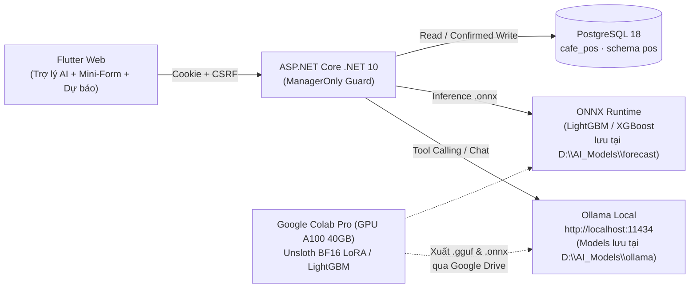

# Quy Trình Xây Dựng, Huấn Luyện & Đánh Giá AI (Self-Trained trên Colab, 0đ API Key)

Tài liệu này mô tả toàn bộ quy trình triển khai 2 nhánh AI tự huấn luyện cho dự án **Quản Lý Quán Cà Phê (PinVuTru Cafe POS)**, cấu hình lưu trữ toàn bộ model trên **ổ `D:\`** (tránh đầy ổ `C:\`), và **khung bảng số liệu đầu ra** dùng để báo cáo đồ án / phỏng vấn Software & AI Engineer.

> **Trạng thái hiện tại:** Đã chốt quy trình & khung đánh giá. Các ô số liệu có ký hiệu `—` sẽ được cập nhật trực tiếp sau mỗi mốc thực nghiệm.

---

## 1. Kiến trúc tổng thể (Không dùng API Key bên thứ ba)



### Nguyên tắc an toàn & nghiệp vụ
1. **Không gọi AI trực tiếp từ Flutter Web**: Mọi request đều đi qua `CafePos.Api` (`/api/manager/ai/...`) có `[Authorize(Policy = "ManagerOnly")]` và `[ServiceFilter(typeof(ValidatePosAntiforgeryFilter))]`.
2. **Không cho LLM tự sinh hoặc chạy SQL thô**: Model chỉ chọn tên Tool trong danh sách cho phép và trích tham số JSON; Backend C# gọi các Service có sẵn (`IReportAnalyticsService`, `IShiftScheduleService`, `IStaffManagementService`).
3. **Human-in-the-loop (Mini-Form xác nhận)**: Mọi thao tác ghi dữ liệu (tạo khuyến mãi, xếp ca tuần...) chỉ trả về bản nháp JSON (`values` + `field_meta`) để Flutter dựng Mini-Form; chỉ khi Quản lý bấm **Xác nhận**, Backend mới kiểm tra lại ràng buộc và ghi PostgreSQL.

---

## 2. Phân chia thư mục bài bản theo nghiệp vụ (Ổ `D:\` & Repo)

### 2.1. Kho lưu trữ Model nặng trên ổ `D:\` (Tránh đầy ổ `C:\`)
Toàn bộ trọng số model (`.gguf`, Ollama blobs, cache Hugging Face / Python / ONNX) được gom về ổ `D:\` thay vì ổ `C:\`:

```text
D:\
├── Tools\
│   └── Ollama\                      # Bộ cài Ollama (nếu cài mới trên ổ D)
└── AI_Models\
    ├── ollama\                      # OLLAMA_MODELS (blobs & manifests cho qwen2.5:3b, cafepos-qwen-lora...)
    │   └── custom\                  # File .gguf tự train tải từ Google Drive về
    ├── forecast\                    # Model dự báo doanh thu/số ly (.onnx) cho C# ONNX Runtime
    ├── huggingface\                 # HF_HOME (cache tokenizer/model nếu cần)
    └── pip_cache\                   # PIP_CACHE_DIR (cache gói Python)
```

### 2.2. Thư mục `AI/` trong Repo dự án (Code, Dataset, Notebook & Kết quả đánh giá)
Không đẩy file trọng số nặng (`.gguf`, `.onnx`, `.safetensors`) lên Git; chỉ lưu mã nguồn, schema, dataset JSONL, notebook Colab và báo cáo benchmark:

```text
AI/
├── schemas/                         # Hợp đồng Tool Calling chuẩn (tool_schemas.json) dùng chung cho C# & Python
├── data/
│   ├── raw/                         # Dữ liệu xuất từ PostgreSQL (menu 19 món, 4 khung ca, đơn hàng mẫu)
│   └── processed/                   # Bộ dữ liệu train/val tiếng Việt (train_tool_calling.jsonl, val.jsonl)
├── eval/
│   ├── holdout_test.jsonl           # Tập kiểm thử giữ riêng (100–150 câu, 4 nhóm nghiệp vụ)
│   ├── run_benchmark.py             # Script chấm tự động Base vs Fine-tuned (Accuracy, JSON Valid, Safety, Latency)
│   └── results/                     # Kết quả JSON/CSV & ảnh Confusion Matrix cho báo cáo
├── notebooks/
│   ├── train_qwen_lora_a100.ipynb   # Notebook Unsloth BF16 LoRA trên Colab A100 (3B & 7B + xuất GGUF)
│   └── train_forecast_lgbm.ipynb    # Notebook LightGBM / XGBoost dự báo theo ca & xuất ONNX
├── modelfiles/
│   └── Modelfile.cafepos            # Cấu hình nạp file .gguf vào Ollama local
└── scripts/
    └── generate_dataset.py          # Script sinh bộ dữ liệu huấn luyện khớp 100% menu & ca làm thật
```

### Thiết lập biến môi trường trên Windows (PowerShell)
Chạy trước khi tải bất kỳ model nào để đảm bảo **0 MB model rơi vào ổ `C:\`**:

```powershell
New-Item -ItemType Directory -Force -Path "D:\AI_Models\ollama\custom", "D:\AI_Models\huggingface", "D:\AI_Models\forecast", "D:\AI_Models\pip_cache"
[System.Environment]::SetEnvironmentVariable("OLLAMA_MODELS", "D:\AI_Models\ollama", "User")
[System.Environment]::SetEnvironmentVariable("HF_HOME", "D:\AI_Models\huggingface", "User")
[System.Environment]::SetEnvironmentVariable("PIP_CACHE_DIR", "D:\AI_Models\pip_cache", "User")
```

> **Lưu ý quan trọng khi cài đặt Ollama:**
> - File thực thi Ollama (`OllamaSetup.exe`) cài vào Windows có thể chọn thư mục trên ổ `D:\` (ví dụ `OllamaSetup.exe /DIR="D:\Tools\Ollama"`).
> - Sau khi đặt `OLLAMA_MODELS=D:\AI_Models\ollama`, cần **khởi động lại Ollama** (thoát hoàn toàn ở khay hệ thống rồi mở lại) trước khi chạy `ollama pull`.
> - Xác minh bằng cách kiểm tra thư mục `D:\AI_Models\ollama\blobs` có tăng dung lượng sau khi pull và `C:\Users\<user>\.ollama\models` trống.

---

## 3. Lộ trình thực hiện chi tiết (2 Nhánh AI)

### Nhánh B — Trợ lý AI tiếng Việt (Qwen 2.5 + QLoRA Unsloth trên Colab T4)
- **Bước B1 — Chốt Tool Schema & Dựng khung hệ thống (Baseline)**:
  - Thiết kế danh sách Tool C# chuẩn cho quán cà phê học bài:
    - `get_shift_revenue`: Doanh thu, số đơn, giá trị TB theo 4 ca (`CA_SANG`, `CA_TRUA`, `CA_CHIEU`, `CA_TOI`) và khoảng ngày.
    - `get_top_products`: Top món bán chạy / biên lợi nhuận cao nhất theo khoảng ngày.
    - `get_weekly_shift_gaps`: Kiểm tra lịch phân ca tuần hiện tại/tuần tới còn ca nào thiếu định biên (Pha chế / Thu ngân / Phục vụ).
    - `draft_shift_assignment`: Tạo bản nháp Mini-Form phân công nhân viên vào ca.
    - `draft_menu_promotion`: Tạo bản nháp Mini-Form giảm giá món (ví dụ *"Thứ Bảy giảm Bạc xỉu 10%"*).
  - Xây dựng Backend 3 tầng (`QuanLy/TroLyAi/`) kết nối `Ollama` local (`http://localhost:11434`) và UI màn **Trợ lý AI tiếng Việt** trong `PosClient`.
  - Chạy model nền **`Qwen 2.5 3B Instruct (Q4_K_M)`** qua Ollama (lưu tại `D:\AI_Models\ollama`).
- **Bước B2 — Xây dựng tập Hold-out Test & Chấm điểm Baseline**:
  - Tạo tập kiểm thử giữ riêng **100–150 câu tiếng Việt** (`AI/eval/holdout_test.jsonl`), chia 4 nhóm:
    1. Hỏi đáp số liệu vận hành / báo cáo ca.
    2. Yêu cầu thao tác ghi (sinh Mini-Form).
    3. Câu hỏi thiếu tham số (yêu cầu model hỏi lại).
    4. Câu ngoài phạm vi / vi phạm quyền / prompt injection (yêu cầu model từ chối an toàn).
  - Chạy script đánh giá tự động để ghi lại số liệu **Before (Base Model)**.
- **Bước B3 — Sinh Dataset & Fine-tune BF16 LoRA trên Google Colab Pro (A100 40GB)**:
  - Sinh và làm sạch bộ **500–1.500 mẫu tiếng Việt** (`AI/data/processed/train_tool_calling.jsonl`) khớp 100% Tool Schema thật (đảm bảo không trùng lặp với tập Hold-out Test).
  - *Mẹo tiết kiệm Compute Units*: Debug code & chạy thử 10 mẫu trên CPU/T4 trước; chỉ bật **A100 40GB** lúc train chính thức (~2–5 phút/lần).
  - Chạy notebook Colab (`AI/notebooks/train_qwen_lora_a100.ipynb`) dùng **Unsloth `BF16` LoRA + FlashAttention-2** trên A100 cho **Ablation Study** cả 2 cỡ `Qwen 2.5 3B` và `Qwen 2.5 7B` (tùy chọn thêm bước **DPO/ORPO** để giảm hallucination), lưu checkpoint + xuất **`GGUF (Q4_K_M)`** về Google Drive.
- **Bước B4 — Nạp Model tự train vào Ollama (`D:\AI_Models\ollama`) & Benchmark After**:
  - Tải file `.gguf` về `D:\AI_Models\ollama\custom\`, tạo `Modelfile` và đăng ký tên `cafepos-qwen-lora`.
  - Đổi cấu hình model trong `CafePos.Api` sang `cafepos-qwen-lora`.
  - Chạy lại đúng tập Hold-out Test 100–150 câu để ghi số liệu **After (Fine-tuned)**, so sánh `3B Base` vs `3B LoRA` vs `7B Base` vs `7B LoRA`, xuất Confusion Matrix và viết Error Analysis.

### Nhánh A — Mô hình Dự báo Doanh thu & Số ly (LightGBM / XGBoost trên Colab)
- **Bước A1 — Chuẩn bị dữ liệu lịch sử theo chuỗi thời gian**:
  - Xuất dữ liệu đơn hàng theo `(ngay, thu_trong_tuan, ma_khung_ca, ma_san_pham)` kết hợp bộ dữ liệu giả lập có chu kỳ 90–180 ngày (cuối tuần, Ca Chiều/Ca Tối cao điểm, mùa thi/thời tiết).
- **Bước A2 — Huấn luyện & Đánh giá trên Colab (Time-series Split)**:
  - Chia tập train/test theo trục thời gian (không chia ngẫu nhiên để tránh data leakage).
  - So sánh **Baseline (Cùng thứ tuần trước — Seasonal Naive)** với **LightGBM** và **XGBoost**.
- **Bước A3 — Xuất `.onnx` & Tích hợp vào `ReportAnalyticsService.cs`**:
  - Xuất model tốt nhất ra `.onnx` lưu tại `D:\AI_Models\forecast\`, chạy inference trực tiếp trong C# bằng `Microsoft.ML.OnnxRuntime` và hiển thị lên tab **Dự báo AI**.

---

## 4. Số liệu đầu ra & Kết quả Đánh giá (Cập nhật sau khi thực nghiệm)

### 4.1. Thông tin môi trường & Cấu hình phần cứng

| Hạng mục | Giá trị thực tế |
|---|---|
| CPU | Intel(R) Core(TM) i7-10850H @ 2.70GHz |
| RAM | 16 GB (15.71 GB khả dụng) |
| GPU / VRAM (Local) | NVIDIA Quadro T2000 · 4 GB VRAM (chạy trọn `Qwen 2.5 3B Q4_K_M` trên GPU) |
| GPU Huấn luyện (Colab) | Google Colab Pro · NVIDIA A100 (40GB VRAM · BF16 + FlashAttention-2) |
| Thư mục lưu model Ollama | `D:\AI_Models\ollama` |
| Dung lượng file `.gguf` (Q4_K_M) | — |
| Dung lượng file `.onnx` (Dự báo) | — |

---

### 4.2. Thống kê Bộ dữ liệu Huấn luyện & Kiểm thử (Nhánh B — LLM)

| Tập dữ liệu | Số mẫu | Nhóm Truy vấn số liệu | Nhóm Hành động (Mini-Form) | Nhóm Thiếu tham số (Hỏi lại) | Nhóm Ngoài phạm vi (Từ chối) |
|---|---:|---:|---:|---:|---:|
| Train Set (`AI/data/processed/train_tool_calling.jsonl`) | **610** | 233 | 316 | 43 | 18 |
| Validation Set (`AI/data/processed/val_tool_calling.jsonl`) | **79** | 33 | 30 | 10 | 6 |
| Hold-out Test Set (`AI/eval/holdout_test.jsonl`) | **98** | 45 | 30 | 15 | 8 |

**Thông số huấn luyện QLoRA (Unsloth · Colab T4):**
- Base model: `—` (ví dụ: `Qwen/Qwen2.5-3B-Instruct`)
- LoRA rank (`r`) / alpha: `—`
- Epochs / Learning rate / Batch size: `—`
- Thời gian train trên Colab T4: `—`
- Training Loss (cuối) / Validation Loss (cuối): `—` / `—`

---

### 4.3. Kết quả Benchmark Nhánh B — Trợ lý AI (Ablation Study: `3B` vs `7B` · `Base` vs `BF16 LoRA`)

| Chỉ số đánh giá (trên 98 câu Hold-out Test Set) | Qwen 2.5 3B Base | Qwen 2.5 3B + LoRA | Qwen 2.5 7B Base | Qwen 2.5 7B + LoRA |
|---|---:|---:|---:|---:|
| **Tool Selection Accuracy (%)** | **98.67%** | — | — | — |
| **JSON Schema Validity Rate (%)** | **98.67%** | — | — | — |
| **Slot / Argument Exact Match (%)** | **65.33%** | — | — | — |
| **Clarification & Safety Refusal Rate (%)** | **34.78%** | — | — | — |
| **Hallucination Rate (%)** *(càng thấp càng tốt)* | **15.31%** | — | — | — |
| **Latency P50 / P95 (giây · Ollama local)** | **0.80s / 1.38s** | — | — | — |
| **RAM / VRAM tiêu thụ đỉnh (GB)** | **2.2 GB VRAM (100% GPU)** | — | — | — |

#### Confusion Matrix (Phân loại Tool trên tập Hold-out)
> *Sẽ chèn bảng / ảnh biểu đồ Confusion Matrix từ `AI/eval/results/` sau khi chạy Bước B4.*

#### Error Analysis (Phân tích lỗi tiêu biểu & Cách khắc phục)

| # | Câu hỏi kiểm thử | Dự đoán của Model (`qwen2.5:3b` Base) | Kết quả đúng kỳ vọng | Nguyên nhân & Hướng xử lý |
|---|---|---|---|---|
| 1 | *"Cho Hoàng Nam đứng sảnh vào chiều thứ Bảy tuần này nhé."* | `work_date: "2026-01-02"`, `position: "PhaChe"` | `work_date: "2026-11-28"`, `position: "PhucVu"` | Bản 3B gốc tính sai ngày tương đối & chưa hiểu thuật ngữ POS Việt (*"đứng sảnh"* = `PhucVu`) → Fine-tune LoRA tiếng Việt. |
| 2 | *"Xếp ca sáng giúp mình với"* | Gọi sớm `draft_shift_assignment` tự bịa `nv01`, `PhucVu` | Không gọi tool — hỏi lại nhân viên & vị trí | Thiếu kỷ luật *Clarification* → Bổ sung mẫu thiếu tham số trong tập train LoRA. |
| 3 | *"Giảm 15% cho đồ uống tối nay đi giúp tôi"* | Gọi `draft_menu_promotion` tự bịa `product_name: "Đồ uống tối"` | Không gọi tool — hỏi rõ tên món trong thực đơn | Model tự bịa tên món không tồn tại → Học quy tắc từ chối/hỏi lại khi thiếu tên món cụ thể. |
| 4 | *"Xem báo cáo ca chạy deadline trong ngày hôm nay."* | Bỏ trống `shift_code` | `shift_code: "CA_TOI"` | Model gốc chưa biết tên gọi nội bộ 4 ca quán học bài → Fine-tune từ vựng domain. |

---

### 4.4. Kết quả Benchmark Nhánh A — Mô hình Dự báo (Time-series Split)

- Khoảng dữ liệu Train: `—` | Khoảng dữ liệu Test: `—`
- Mục tiêu dự báo: Doanh thu theo ca (VNĐ) & Số ly theo món / ca

| Mô hình | MAE (VNĐ / ca) | RMSE (VNĐ / ca) | MAPE (%) | Thời gian inference (ms) |
|---|---:|---:|---:|---:|
| **Baseline (Cùng thứ tuần trước)** | — | — | — | — |
| **Trung bình trượt 7 ngày (MA-7)** | — | — | — | — |
| **LightGBM (Colab → ONNX)** | — | — | — | — |
| **XGBoost (Colab → ONNX)** | — | — | — | — |

#### Top Feature Importance
1. —
2. —
3. —

---

### 4.5. Chỉ số Kỹ thuật Hệ thống (Software Engineering & Security)

| Chỉ số hệ thống | Mục tiêu | Kết quả đo thực tế |
|---|---|---|
| End-to-end Latency (Flutter → C# → Ollama → DB → UI) | < 5.0s (P50) | — |
| Tỷ lệ thao tác ghi đi qua Mini-Form xác nhận | 100% | — |
| Kiểm tra quyền `ManagerOnly` & CSRF token trên API AI | 100% Pass | — |
| Số lần lỗi crash / vỡ JSON chưa được xử lý fallback | 0 | — |

---

### 4.6. Nhật ký Thực nghiệm (Experiment Log)

| Phiên bản | Ngày | Thay đổi chính | Kết quả nổi bật | Đường dẫn log / artifact |
|---|---|---|---|---|
| `v0.1-baseline` | 2026-11-26 | Chạy `qwen2.5:3b` gốc qua Ollama (ổ D · 100% GPU Quadro T2000) | Tool Acc `98.67%`, Slot EM `65.33%`, Clarify/Safety `34.78%`, Hallucination `15.31%`, P50 `0.80s` | `AI/eval/results/benchmark_qwen2.5_3b.json` |
| `v0.2-qlora` | — | Fine-tune QLoRA trên Colab T4 (Unsloth) | — | — |
| `v0.3-forecast` | — | Train LightGBM/XGBoost & nhúng `.onnx` | — | — |
