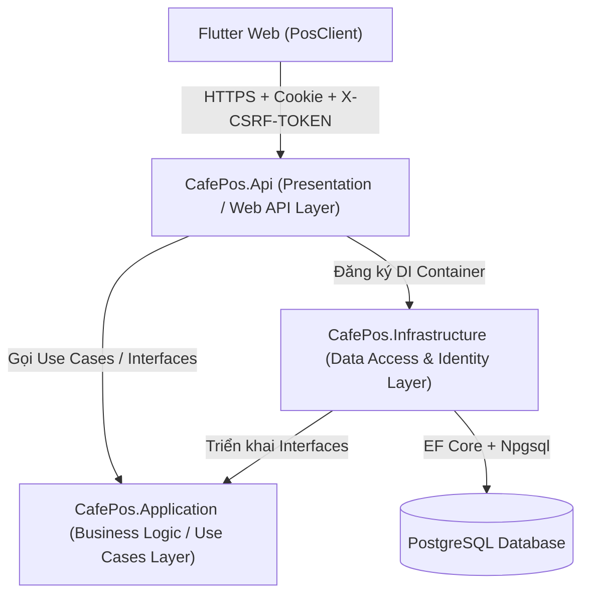
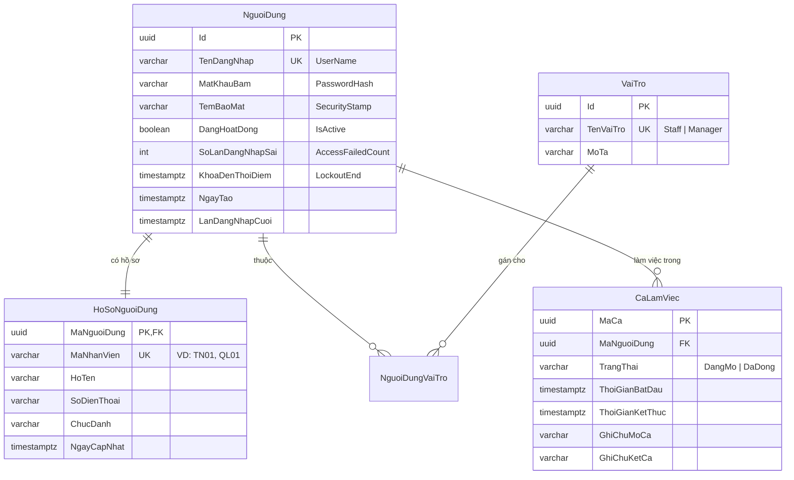
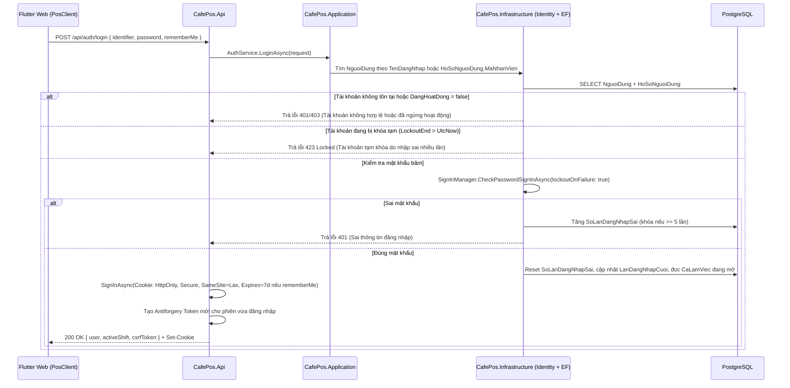

# Thiết kế kỹ thuật: Luồng Đăng nhập & Quản lý Ca làm việc POS (PinVuTru Cafe)

Tài liệu này đặc tả chi tiết kiến trúc hệ thống, thiết kế bảo mật, mô hình cơ sở dữ liệu PostgreSQL và luồng tương tác giữa **Flutter Web (`PosClient`)** với **Backend ASP.NET Core 3 lớp (`CafePos.Api`, `CafePos.Application`, `CafePos.Infrastructure`)**.

---

## 1. Bảng phân vai công nghệ trong luồng Đăng nhập & Ca làm việc

| Tên công nghệ | Chức năng trong hệ thống |
|---|---|
| **Flutter Web** | Hiển thị form đăng nhập và ô **Ghi nhớ đăng nhập trên thiết bị này**. Khi mở lại web, tự động gọi `GET /api/auth/me` (kèm cookie trình duyệt) để khôi phục phiên và hiển thị **Bắt đầu ca** (nếu chưa có ca mở) hoặc **Tiếp tục ca** (nếu đang có ca mở). |
| **ASP.NET Core Web API** | Cung cấp các endpoint RESTful: `POST /api/auth/login`, `POST /api/auth/logout`, `GET /api/auth/me`, `GET /api/auth/antiforgery`, `POST /api/shifts/start`, `POST /api/shifts/end`, `PUT /api/profile`. |
| **ASP.NET Core Identity** | Tìm tài khoản theo mã nhân viên hoặc tên đăng nhập, xác minh mật khẩu băm (`PBKDF2 / PasswordHasher`), đếm số lần nhập sai (`AccessFailedCount`) và khóa tạm (`LockoutEnd`) khi vượt giới hạn (ví dụ: nhập sai 5 lần khóa 15 phút). |
| **ASP.NET Core Cookie Authentication** | Duy trì phiên đăng nhập. Nếu chọn **Ghi nhớ**, phát hành persistent cookie thời hạn tối đa **7 ngày** (`SlidingExpiration = true`). Nếu bỏ chọn, phát hành session cookie theo phiên trình duyệt. Cookie được gắn cờ `HttpOnly = true`, `Secure = Always` và `SameSite = Lax`. |
| **ASP.NET Core Authorization** | Phân quyền `Staff` và `Manager` trên từng API. Tích hợp `SecurityStampValidator` và kiểm tra trạng thái `DangHoatDong` để tự động thu hồi/từ chối phiên cũ ngay khi tài khoản bị khóa hoặc thay đổi quyền. |
| **ASP.NET Core Antiforgery** | Bảo vệ chống tấn công CSRF cho mọi thao tác thay đổi dữ liệu sử dụng xác thực bằng cookie (`POST /api/shifts/start`, `POST /api/shifts/end`, `PUT /api/profile`, `POST /api/auth/logout`) thông qua header `X-CSRF-TOKEN`. |
| **EF Core + Npgsql** | Ánh xạ các thực thể sang bảng tiếng Việt trong PostgreSQL (`NguoiDung`, `VaiTro`, `HoSoNguoiDung`, `CaLamViec`), quản lý migration và thực thi giao dịch (transaction). |
| **PostgreSQL** | Lưu trữ dữ liệu định danh, hồ sơ và lịch sử ca làm việc. Áp dụng **Unique Filtered Index** (`WHERE "TrangThai" = 'DangMo'`) trên bảng `CaLamViec` để đảm bảo mỗi nhân viên chỉ có tối đa một ca đang mở tại một thời điểm, chặn triệt để lỗi tạo trùng khi bấm đúp. |
| **HTTPS** | Mã hóa toàn bộ thông tin nhạy cảm (mật khẩu, cookie phiên, CSRF token) trên đường truyền giữa trình duyệt và backend. |

---

## 2. Kiến trúc Backend 3 lớp Top-Tier

Hệ thống tuân thủ nguyên tắc phân tách trách nhiệm (Separation of Concerns) và quy tắc phụ thuộc một chiều:



| Lớp | Trách nhiệm trong dự án | Thành phần chính |
|---|---|---|
| **`CafePos.Api`** | Nhận request HTTP từ Flutter Web, kiểm tra quyền truy cập (`[Authorize]`), xác thực mã chống CSRF, cấp hoặc xóa Cookie phiên và trả kết quả HTTP chuẩn. | `AuthController`, `ShiftsController`, `ProfileController`, cấu hình Cookie, CORS, Antiforgery và HTTPS. |
| **`CafePos.Application`** | Chứa thực thể nghiệp vụ, DTOs, quy tắc nghiệp vụ cốt lõi: chỉ cho phép tài khoản `DangHoatDong = true` đăng nhập, mỗi nhân viên có tối đa 1 ca đang mở (`DangMo`), kiểm tra điều kiện kết ca/trả bàn. Không phụ thuộc vào EF Core hay chi tiết HTTP. | `IAuthService`, `IShiftService`, `Entities` (`HoSoNguoiDung`, `CaLamViec`), `DTOs`, `ServiceResult<T>`. |
| **`CafePos.Infrastructure`** | Kết nối PostgreSQL qua EF Core & Npgsql, ánh xạ các bảng tiếng Việt (`NguoiDung`, `VaiTro`, `HoSoNguoiDung`, `CaLamViec`), tích hợp `ASP.NET Core Identity`, thực hiện transaction và xử lý ngoại lệ ràng buộc duy nhất từ DB. | `CafePosDbContext`, `AppIdentityUser`, `AppIdentityRole`, `AuthService`, `ShiftService`, `DbInitializer`. |

---

## 3. Thiết kế Cơ sở dữ liệu PostgreSQL (Ánh xạ bảng tiếng Việt)



### Ràng buộc chống tạo trùng ca đang mở (PostgreSQL Unique Partial Index)
Trong `CafePosDbContext` (`OnModelCreating`):
```sql
CREATE UNIQUE INDEX "IX_CaLamViec_MaNguoiDung_DangMo"
ON "CaLamViec" ("MaNguoiDung")
WHERE "TrangThai" = 'DangMo';
```
- Ngay cả khi nhân viên bấm đúp nút **Bắt đầu ca** 2 lần liên tiếp trong cùng mili-giây, PostgreSQL chỉ cho phép tối đa 1 dòng có `TrangThai = 'DangMo'` cho mỗi `MaNguoiDung`.
- `ShiftService` trong `CafePos.Infrastructure` bọc thao tác mở ca trong transaction và bắt lỗi `UniqueConstraint`, trả về luôn ca đang mở hiện tại (idempotent) thay vì làm sập request.

---

## 4. Luồng hoạt động chi tiết

### 4.1. Luồng Đăng nhập & Cấp Cookie (`POST /api/auth/login`)



### 4.2. Luồng Khôi phục phiên khi mở lại trình duyệt (`GET /api/auth/me`)

1. Khi mở lại tab Flutter Web, ứng dụng gọi ngay `GET /api/auth/me` với `credentials: include`.
2. **Cookie Authentication & SecurityStampValidator**:
   - Kiểm tra hạn cookie (còn trong 7 ngày nếu trước đó chọn *Ghi nhớ*, hoặc còn trong phiên trình duyệt).
   - Kiểm tra `SecurityStamp` và cờ `DangHoatDong` trong bảng `NguoiDung`. Nếu quản lý vừa khóa tài khoản hoặc đổi quyền (`Staff` ↔ `Manager`), `SecurityStamp` không khớp → hệ thống tự động hủy cookie và trả `401 Unauthorized`.
3. Nếu phiên hợp lệ:
   - Backend truy vấn `HoSoNguoiDung`, danh sách `VaiTro`, và ca làm việc có `TrangThai = 'DangMo'` (nếu có).
   - Phát hành kèm `csrfToken` mới để Flutter Web gắn vào header `X-CSRF-TOKEN` cho các thao tác tiếp theo.
4. Trên giao diện **Flutter Web**:
   - Nếu `activeShift == null`: Hiển thị thẻ chào mừng nhân viên kèm nút chính **`Bắt đầu ca`**.
   - Nếu `activeShift != null`: Hiển thị thông tin ca đang mở (giờ bắt đầu, mã ca) kèm nút chính **`Tiếp tục ca`** và nút phụ **`Kết thúc ca`**.

### 4.3. Luồng Bắt đầu ca (`POST /api/shifts/start`) & Kết thúc ca (`POST /api/shifts/end`)

- Yêu cầu phải có:
  1. Cookie xác thực hợp lệ với role `Staff` hoặc `Manager`.
  2. Header `X-CSRF-TOKEN` khớp với Antiforgery Cookie (`IAntiforgery.ValidateRequestAsync`).
- **Khi bấm `Bắt đầu ca` (`POST /api/shifts/start`)**:
  - Tầng `Application`/`Infrastructure` kiểm tra nhân viên đã có ca `DangMo` chưa.
  - Nếu đã có ca `DangMo`, trả về luôn ca hiện tại (tránh tạo trùng).
  - Nếu chưa có, mở transaction và thêm bản ghi `CaLamViec` mới với `TrangThai = 'DangMo'`, `ThoiGianBatDau = DateTimeOffset.UtcNow`.
- **Khi bấm `Kết thúc ca` (`POST /api/shifts/end`)**:
  - Tìm ca `DangMo` của nhân viên hiện tại.
  - Cập nhật `TrangThai = 'DaDong'`, `ThoiGianKetThuc = DateTimeOffset.UtcNow` và `GhiChuKetCa`.
